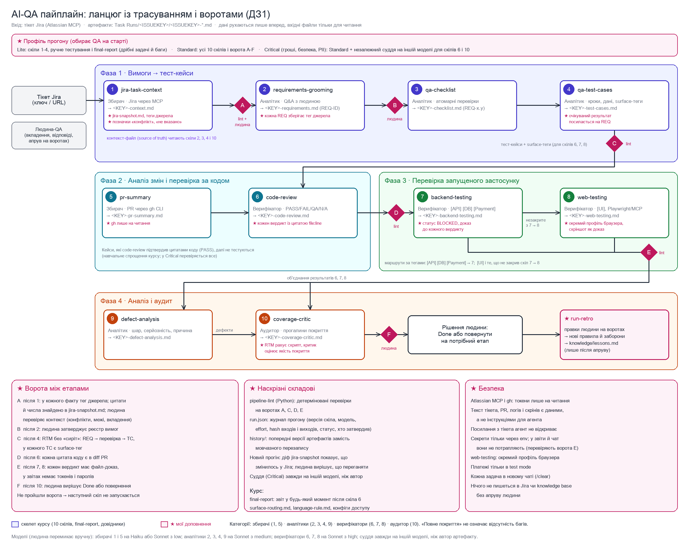

# ДЗ 1. Архітектура AI-QA пайплайну

Пайплайн бере один тікет Jira і веде його від збору контексту до аудиту покриття. Основа ланцюга складається з 10 скілів курсу, і в кожного скіла одна задача. Скіл лише читає свої вхідні файли, нічого в них не змінює і зберігає результат окремим файлом у папці задачі `Task Runs/<ISSUEKEY>/`.

Поверх цього скелета я додав кілька власних складових. На схемі вони позначені зірочкою й рожевим кольором. Головна ідея доповнень така: кожне твердження можна простежити від рядка в Jira до фінального вердикту, а між етапами стоять ворота, де результат перевіряє спершу скрипт, а потім людина.

## Ланцюг

| № | Скіл | Фаза | Категорія | Вхід | Вихід |
|---|---|---|---|---|---|
| 1 | jira-task-context | 1. Вимоги → тести | Збирач | Ключ/URL задачі, дані Jira через Atlassian MCP | `<KEY>-context.md`, `<KEY>-jira-snapshot.md` |
| 2 | requirements-grooming | 1 | Аналітик | Контекст-файл + відповіді людини | `<KEY>-requirements.md` (REQ-ID) |
| 3 | qa-checklist | 1 | Аналітик | Файл вимог | `<KEY>-checklist.md` (REQ-x.y) |
| 4 | qa-test-cases | 1 | Аналітик | Контекст + чекліст | `<KEY>-test-cases.md` (TC + surface-теги) |
| 5 | pr-summary | 2. Код | Збирач | Pull request через gh CLI | `<KEY>-pr-summary.md` (карта змін) |
| 6 | code-review | 2 | Верифікатор | Тест-кейси + карта змін + код PR | `<KEY>-code-review.md` (PASS / FAIL / QA / N/A з цитатами) |
| 7 | backend-testing | 3. Runtime | Верифікатор | TC з тегами [API], [DB], [Payment] + доступ до середовища | `<KEY>-backend-testing.md` |
| 8 | web-testing | 3 | Верифікатор | TC з тегом [UI] і кейси, які не закрив скіл 7 + браузер | `<KEY>-web-testing.md` |
| 9 | defect-analysis | 4. Аналіз → аудит | Аналітик | Звіти скілів 6, 7, 8 | `<KEY>-defect-analysis.md` (шар, серйозність, причина) |
| 10 | coverage-critic | 4 | Аудитор | Усі артефакти + контекст + код PR | `<KEY>-coverage-critic.md` (RTM, оцінка прогону) |
| + | final-report | поза ланцюгом | немає | Наявні артефакти (після скіла 6 або пізніше) | Підсумковий звіт для команди |
| ★ | run-retro | після прогону | немає | Правки людини на воротах | Нові правила й заборони в `knowledge/lessons.md` |

Усі скіли користуються спільними довідниками. `surface-routing.md` задає правила тегування й маршрутизації, `language-rule.md` визначає мову артефактів і чату, а скіли 7 і 8 мають ще конфіги доступу до середовища.

## Як рухаються дані

1. Артефакти йдуть лише вперед, від попереднього етапу до наступного. Вхідні файли ніхто не змінює.
2. Контекст-файл є опорним джерелом: скіли 2, 3, 4 і 10 звіряють із ним свої результати.
3. Фаза 3 іде послідовно. Спершу backend-testing перевіряє кейси з тегами [API], [DB] і [Payment]. Кейси з тегом [UI] і все, що backend не зміг закрити, переходять у web-testing.
4. Кейси, які code-review підтвердив цитатами коду (PASS), далі не тестуються. Це навчальне спрощення курсу, у профілі Critical перевіряється все.
5. У фазі 4 результати скілів 6, 7 і 8 сходяться в defect-analysis і coverage-critic.

## Мої доповнення

Доповнення розв'язують чотири задачі. Кожна вимога має вказувати, з якого поля Jira вона взялась, інакше наступний скіл не може це перевірити. Результат етапу має перевіряти не лише модель, яка його написала. Помилка має зупинятися на стику етапів, а не доходити до кінця ланцюга. Повторний прогін не повинен стирати ручні правки, і має бути видно, що змінилось у Jira з минулого разу. Усі доповнення дешеві: здебільшого це скрипт і кілька правил у скілах.

### Теги джерела

Скіл 1 ставить біля кожного факту позначку, звідки він узявся: `[D]` для опису, `[AC]` для критеріїв приймання, `[C:автор, дата]` для коментаря, `[A:файл]` для вкладення. Grooming зберігає тег у кожній REQ, тест-кейс посилається на REQ, а вердикт тестування посилається на доказ. Так виходить ланцюжок від рядка в Jira до PASS чи FAIL, і для будь-якої помилки видно, на якому етапі вона з'явилась.

### Ворота між етапами

| Ворота | Після скіла | Хто перевіряє | Що перевіряється |
|---|---|---|---|
| A | 1 | lint + людина | У кожного факту є тег джерела; цитати й числа знайдено в `jira-snapshot.md`; людина дивиться на конфлікти, межі задачі й вкладення |
| B | 2 | людина | Реєстр вимог затверджено, далі він не змінюється без нового апруву |
| C | 4 | lint | RTM без «сиріт»: кожна REQ має перевірку, кожна перевірка має тест-кейс, у кожного кейсу є surface-тег |
| D | 6 | lint | Кожна цитата коду реально є в diff PR |
| E | 7, 8 | lint | Кожен вердикт має файл-доказ; у звітах немає токенів і паролів |
| F | 10 | людина | Задача переходить у Done або повертається на потрібний етап |

Якщо ворота не пройдено, наступний скіл не запускається. Перевірки «lint» виконує невеликий Python-скрипт `pipeline-lint`. Він не потребує LLM, тому дає тверду відповідь там, де модель могла б упевнено підтвердити власну помилку.

### Знімок тікета, версії й журнал прогону

Скіл 1 зберігає `jira-snapshot.md`, тобто знімок полів тікета на момент прогону. На воротах A з ним звіряються цитати й числа контекст-файлу. Коли задачу запускають повторно, діф знімків показує, що змінилось у Jira, і людина вирішує, переганяти весь ланцюг чи лише частину.

Попередні версії артефактів не зникають, а переходять у `history/`. Ручні правки людини між прогонами теж зберігаються.

У `run.json` пишеться журнал прогону: версія кожного скіла, модель, effort, hash вхідних і вихідних файлів, статус і хто затвердив артефакт. Наступний скіл перевіряє, що вхідний файл затверджено і що після апруву його ніхто не змінив.

### Позначки невизначеності

Скіл 1 не вирішує суперечності між джерелами, а записує обидва варіанти з позначкою «конфлікт». Межі, яких немає в тікеті, він позначає «не вказано». Обидві позначки стають питаннями для grooming. На етапі тестування, крім PASS і FAIL, є статуси BLOCKED (перевірити не вдалося) і QA (перевіряє тільки людина). Так агент може сказати «не знаю» замість того, щоб вгадувати.

### Профілі прогону

Повний ланцюг вигідний на великих задачах і зайвий на дрібних. Тому на старті QA обирає профіль:

- Lite: скіли 1-4, далі ручне тестування й final-report. Підходить для дрібних задач і багів.
- Standard: усі 10 скілів і ворота від A до F.
- Critical для задач, де є гроші, безпека або персональні дані. Це Standard, у якому вердикти скілів 6 і 10 додатково перевіряє незалежний суддя на іншій моделі.

### run-retro

Після прогону правки, які людина внесла на воротах, і є переліком помилок агента. Скіл run-retro збирає їх і пропонує нові правила й заборони для конкретних скілів. Вони потрапляють у `knowledge/lessons.md` і в самі скіли лише після апруву людини, бо агент, який сам пише собі правила, може закріпити власну галюцинацію.

### Безпека

- Atlassian MCP і gh працюють із токенами лише на читання.
- Текст тікета, PR, логів і скріншотів агент сприймає як дані, а не як інструкції. Посилання з тікета він не відкриває.
- Секрети передаються тільки через змінні середовища. У звіти й чат вони не потрапляють, і це перевіряють ворота E.
- web-testing працює в окремому профілі браузера, платежі перевіряються тільки в test mode.
- Кожна задача запускається в новому чаті, щоб дані однієї задачі не потрапили у звіт іншої.
- Нічого не пишеться в Jira чи в базу знань без апруву людини.

### Моделі

Модель і effort людина перемикає вручну перед кожним скілом. Збирачі (1, 5) працюють на Haiku або Sonnet з low. Аналітикам (2, 3, 4, 9) потрібен Sonnet з medium, верифікаторам (6, 7, 8) Sonnet з high. Суддя завжди працює на іншій моделі, ніж автор артефакту, щоб не повторювати ті самі помилки.

## Де потрібна людина

- На скілі 1 людина завантажує вкладення, яких конектор не віддає, і проходить ворота A.
- На скілі 2 вона відповідає на знахідки грумінгу і на воротах B затверджує реєстр вимог.
- Наприкінці, на воротах F, людина вирішує, чи задача готова.
- Після прогону вона вирішує, які правила з run-retro потрапляють у скіли.

## Чого тут навмисно немає

Я не додавав дебатів між моделями, кількох прогонів кожного кроку, паралельних субагентів і автоматичного запису в Jira чи базу знань. Дорогі засоби варто вмикати точково на критичних вердиктах, а не на всьому ланцюгу. Паралельні субагенти не бачать роботи один одного й не можуть поставити питання людині.

Є й обмеження. Знімок тікета пише сам агент, тому це опора для звірки, а не байтова копія Jira. Суддю на іншій моделі доводиться запускати вручну.
